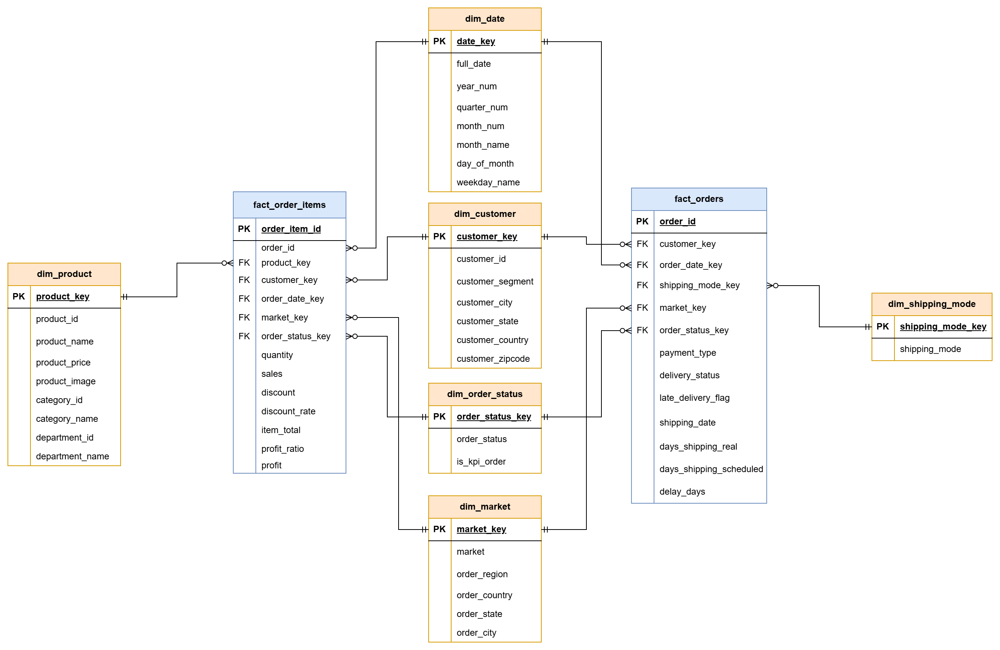
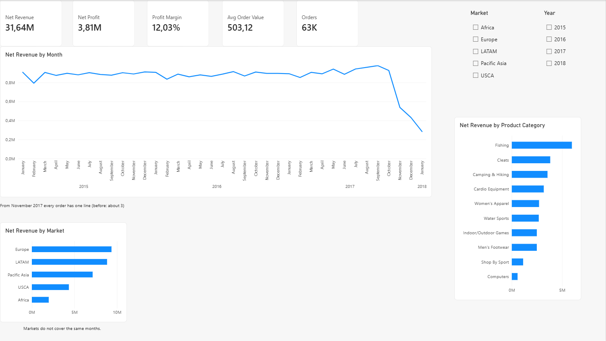
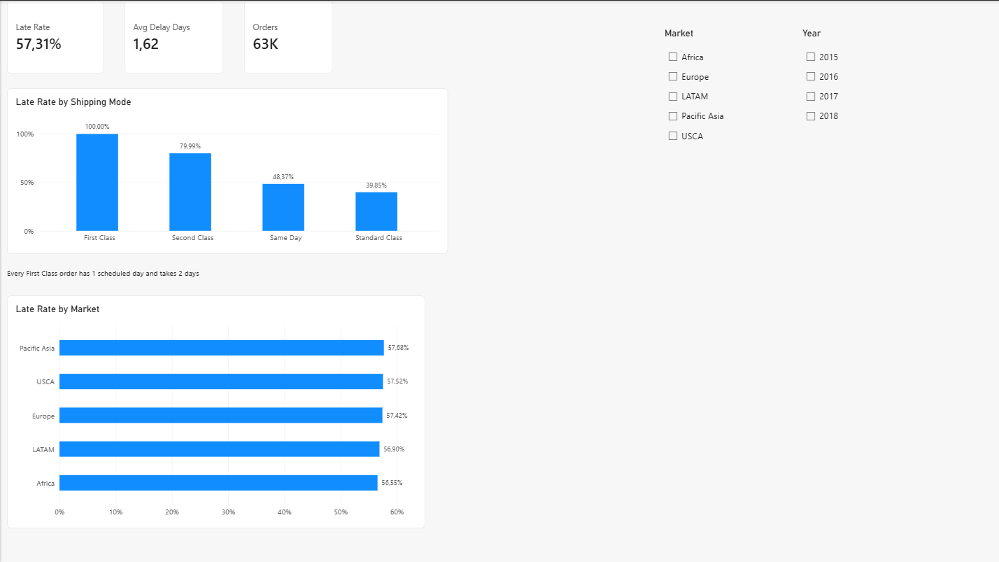

# DataCo Supply Chain Data Warehouse
 
In this project I built a small data warehouse from a supply chain dataset. I load the data into SQL Server with Python, clean it with SQL, put it in a star schema, and show the results in a Power BI report.
 
I did it to learn how a real data pipeline works, step by step. I wrote down every decision I made in [docs/decisions.md](docs/decisions.md).
 
## The data
 
I used the DataCo Smart Supply Chain dataset (Mendeley Data / Kaggle, licence CC BY 4.0).
 
- 180,519 rows and 53 columns in one flat table
- Each row is one product in an order
- 65,752 orders, 20,652 customers and 118 products
- Orders from January 2015 to January 2018
## How it works
 
```
CSV -> staging -> clean -> dw -> Power BI
```
 
- **staging**: the CSV as it is, everything as text
- **clean**: I fix the types and the problems in the data, and keep the 37 columns I need (out of 53)
- **dw**: the star schema, with 6 dimensions and 2 fact tables
- **Power BI**: the report

Python loads the file and runs the SQL files one after the other. After each step it runs quality checks. If a check fails, the pipeline stops.
 
## The star schema
 

 
I made two fact tables, because the data has two levels:
 
- `fact_order_items`: one row for each product in an order (180,519 rows). Revenue and profit are here.
- `fact_orders`: one row for each order (65,752 rows). Shipping and delays are here.

If I used only one table, the delay of an order with 3 products would be counted 3 times. So the two fact tables are never joined to each other. Each number in the report comes from one fact table and its dimensions.
 
The dimensions are `dim_date`, `dim_customer`, `dim_product`, `dim_market`, `dim_order_status` and `dim_shipping_mode`.
 
## KPIs
 
| KPI | Value |
|---|---|
| Net revenue | 31.64M |
| Net profit | 3.81M |
| Profit margin | 12.03% |
| Average order value | 503.12 |
| Late delivery rate | 57.31% |
| Average delay (only late orders) | 1.62 days |
| Number of orders | 62,897 |
 
I don't count the orders with status `CANCELED` or `SUSPECTED_FRAUD` (2,855 orders). With them the revenue would be 33.05M. This is my own assumption, and I explain it in decision 9.
 
I checked every number in Power BI against a SQL query.
 
## The report
 

 

 
The file is in `powerbi/dataco_report.pbix`.
 
## Data quality
 
There are 13 checks after the clean step and 15 after the dw step. For example, they check that the row counts match, that revenue is the same, and that every key in a fact table exists in its dimension.
 
Problems I found in the data and fixed:
 
- wrong text encoding (the file is cp1252)
- the same country with two names
- 3 rows where the customer columns were shifted
- zip codes saved as numbers, so the zeros at the start were lost
### Things I saw in the data (I did not change them)
 
- **From November 2017 every order has only one line.** Before that an order has about 3 lines. The number of orders stays the same, but the revenue per month gets much smaller.
- **The markets do not cover the same months.** Africa has 6 months of data and USCA 10. Europe has orders in 18 of 31 months. So revenue by market is not a fair comparison.
- **Every First Class order is late.** The scheduled days are always the same for each shipping mode, and every First Class order takes 2 days instead of 1.

I don't know the reason for any of these. The queries that show them are in `scripts/checks/`.
 
## Project structure
 
```
dataco-dw
+---data
+---docs
+---powerbi
+---scripts
|   \---checks
+---tests
\---src
```
 
- `data`: the CSV file (it is not stored in the repository, see How to run)
- `docs`: decisions, diagrams and screenshots
- `powerbi`: the report
- `scripts`: the SQL files (clean, dimensions, facts)
- `scripts/checks`: queries I used to look at the data
- `tests`: the quality checks
- `src`: the Python code

## How to run

### Requirements
- Windows with Python 3.11
- SQL Server (Express or Developer edition) and the ODBC Driver 18 for SQL Server
- A Windows account with access to the SQL Server (the connection uses Windows Authentication)
- The DataCo Smart Supply Chain dataset (`DataCoSupplyChainDataset.csv`)

### Steps

1. Install the Python packages:
   ```
   pip install -r requirements.txt
   ```
2. Download `DataCoSupplyChainDataset.csv` and put it in the `data/` folder (the data is not stored in this repository).
3. Create a file named `.env` in the project root. Copy `.env.example` and change the values to match your SQL Server:
   ```
   DB_SERVER=localhost\SQLEXPRESS
   DB_NAME=DataCoDW
   DB_DRIVER=ODBC Driver 18 for SQL Server
   ```
4. Create the database and its schemas once, by running `scripts/00_create_database.sql` in SQL Server Management Studio or VS Code.
5. Run the pipeline:
   ```
   python src/run_pipeline.py
   ```

The pipeline loads the CSV into `staging`, builds the `clean` and `dw` layers with SQL, and runs the quality checks after each layer. It stops with a message if any check fails.